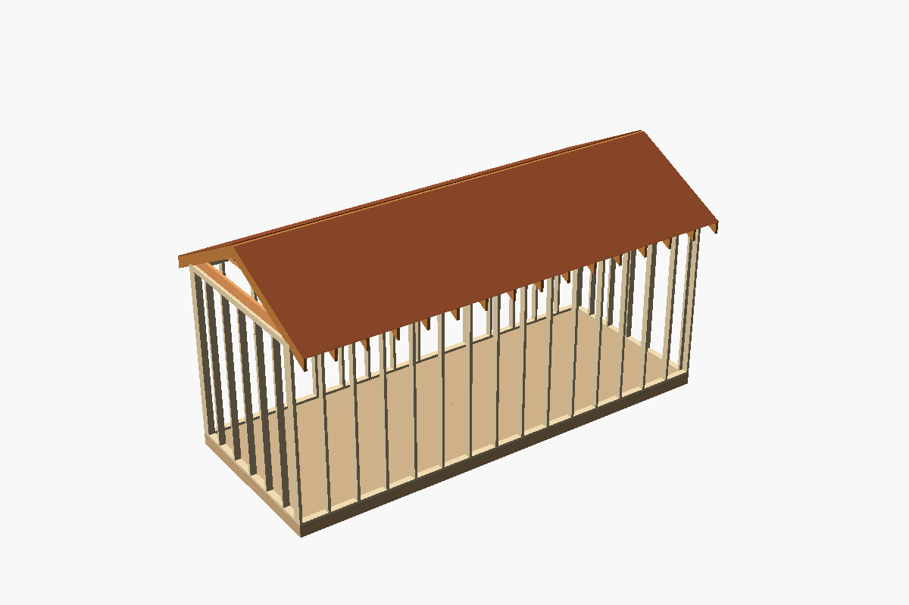
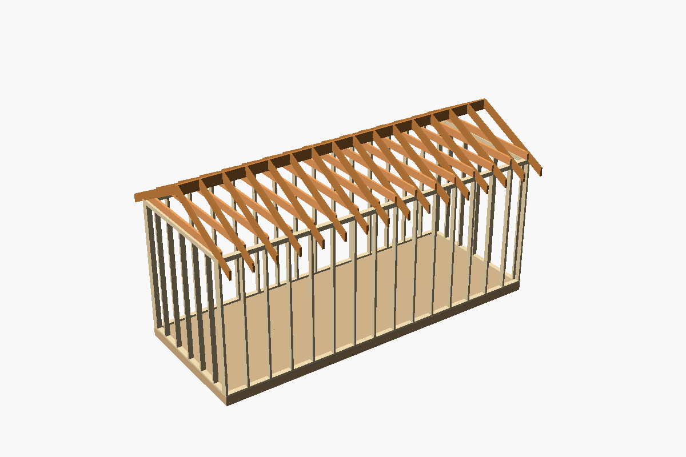
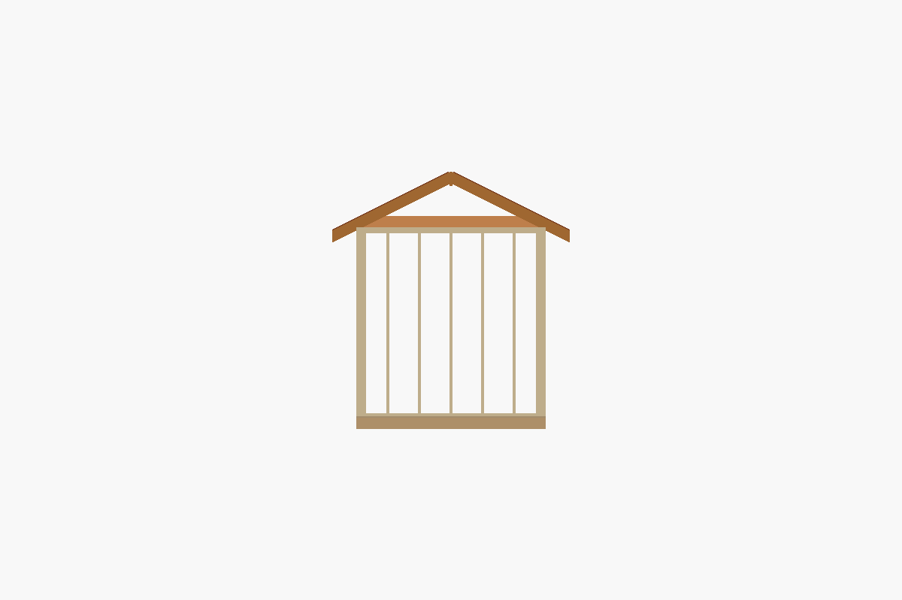
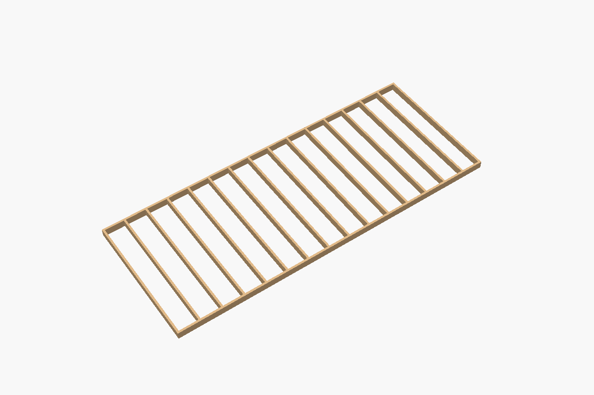

# The Tiny

A parametric tiny house frame in OpenSCAD: a floor platform, four stud walls
and a gable roof. Set the size and the lumber, and it frames the house on a
16 in grid and prints a cut list of what to buy.





## Use it

Open `src/house.scad` in [OpenSCAD](https://openscad.org). All sizes are in
inches.

| Parameter | Default | Description |
| --- | --- | --- |
| `length`, `width` | 240, 96 | Outside size of the floor and walls. The ridge runs along the length. |
| `wall_height` | 96 | Bottom plate to the top of the top plates. |
| `spacing` | 16 | Distance between joist, stud and rafter centres: 12, 16 or 24, so sheet joints land on framing. |
| `joist`, `stud`, `rafter` | `"2x6"`, `"2x4"`, `"2x6"` | Lumber sizes. |
| `stock_feet` | `[8, 10, 12, 14, 16]` | Lumber lengths you can buy, in feet. |
| `pitch` | 6 | Roof rise per 12 in. |
| `overhang` | 12 | Eave overhang, measured level from the wall. |
| `ridge_vent` | 1 | Gap left in the roof sheathing each side of the ridge. |
| `subfloor`, `roof_sheet` | `"ply 3/4"`, `"ply 1/2"` | Sheet goods. |
| `show_floor`, `show_subfloor`, `show_walls`, `show_roof`, `show_roof_sheathing` | `true` | Show or hide each layer. |

The console prints the cut list. For the defaults:

```
The Tiny: 240 x 96 in, walls 96 in, 6/12 roof
Top plates at 102.25 in; ridge board (2x8) top at 130.27 in
Birdsmouth: seat 3.5 in, notch 1.75 in deep
Buy 2x4: 58 @ 8', 6 @ 14'
  cut 2x4: 2 x 76.5 in, 4 x 80 in, 4 x 89 in, 46 x 91.5 in, 2 x 96 in, 2 x 156.5 in, 4 x 160 in
Buy 2x6: 66 @ 8', 2 @ 14'
  cut 2x6: 32 x 66.25 in, 2 x 80 in, 16 x 93 in, 16 x 96 in, 2 x 160 in
Buy 2x8: 1 @ 8', 1 @ 14'
  cut 2x8: 1 x 80 in, 1 x 160 in
Buy ply 3/4: 6 sheets
Buy ply 1/2: 12 sheets
```

`just cutlist -D length=192 -D width=90` prints it for another size without
opening OpenSCAD. It buys one stick per piece at the shortest length that
fits, and one sheet per sheet piece; it doesn't plan cutting several pieces
from one stick.



## How it's framed

- **Floor.** Rim joists run the length of the house; joists span the width
  between them, one flush at each end and the rest on the grid. The subfloor
  runs across the joists in 4' rows, every other row shifted 4', so every
  sheet end lands on a joist.
- **Walls.** The front and back walls run the full length and the end walls
  fit between them. Each has a bottom plate, studs flush at both ends and on
  the grid between, and a double top plate. The end walls' upper top plates
  lap over the long walls.
- **Roof.** Rafter pairs sit on the same grid as the studs, plus one pair
  flush with each end wall. Each rafter has a plumb cut against the ridge board, a
  birdsmouth seat on the top plate, and a plumb-cut tail. The seat is the
  wall's full depth unless that would notch more than a third of the rafter.
  The ridge board is the first size deeper than the rafter's plumb cut. A
  ceiling joist beside each pair ties the walls together, its ends cut to the
  roof line. Sheathing rows are staggered like the subfloor.
- **Long runs.** A rim joist, plate or ridge board longer than the longest
  stock is spliced, and each joint lands on a joist, stud or rafter. Upper
  top plate joints sit half a piece away from the joints below them.

Sizes that can't be built stop with a message, for example a width whose
joists are longer than any stock, or a roof too low for the ties to pass
under the ridge board.



## Checks

`just test` takes about 2 s on OpenSCAD 2026.10.15. It builds the house at
four sizes: the default, a 9'2" wide house on 24 in centres at 8/12, a 30'
house in 2x8 and 2x6 on 12 in centres at 4/12 with no overhang, and a 12' x 7'
house at 12/12. For each it checks that:

- every piece has its stock's cross-section and fits the longest stock;
- no two members overlap, rafters, ties and roof sheathing included;
- the subfloor covers the floor exactly, in staggered rows;
- every splice joint lands on a member, and upper plate joints sit at least
  24 in from the ones below;
- every rafter sits its full seat on a top plate, and no notch is deeper than
  a third of the rafter;
- the cut list buys one piece of the right stock for every member.

It also checks that four sizes that can't be built are refused. `just images`
renders the pictures.

## Not covered yet

There are no doors or windows, so no headers. The gable ends aren't framed or
sheathed, and the walls aren't sheathed. Nothing checks spans or loads: pick
the joist and rafter sizes from your local span tables. Planned work is in the
[issue tracker](https://github.com/CameronBrooks11/TheTiny/issues).

## Licence

MIT; see [LICENSE](LICENSE).
